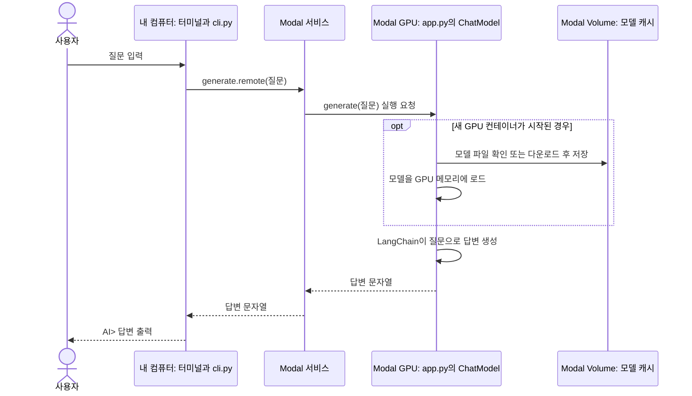

# modal-chat 이해하기

이 앱은 **내 컴퓨터의 터미널에서 질문을 입력하고, Modal의 GPU에서 AI 모델이 만든 답변을 받아 출력**합니다. AI 모델은 내 컴퓨터에서 실행되지 않습니다. 외부 AI API로 질문을 전달하는 방식도 아닙니다. Modal이 제공하는 컴퓨터에서 오픈 모델 `Qwen/Qwen3-1.7B`를 직접 실행하며, LangChain이 모델 호출을 감쌉니다.

## 먼저 실행해 보기

아래 명령은 **저장소 루트**(`ai-example/`)에서 실행합니다. Python 3.12, uv, Modal 계정이 필요하며, Modal에서 GPU를 사용하려면 결제 수단을 등록해야 합니다.

```sh
uv sync --package modal-chat
uv run --package modal-chat modal setup
uv run --package modal-chat modal run -q -m modal_chat.app
```

`modal setup`은 Modal 계정 인증을 위해 처음 한 번만 실행합니다. 이후에는 마지막 명령으로 앱을 시작하면 됩니다.

```text
질문을 입력하세요. 종료하려면 /exit를 입력하세요.
질문> 안녕하세요?
AI> 안녕하세요! 무엇을 도와드릴까요?
질문> /exit
```

`AI>` 뒤의 답변은 실행할 때마다 달라질 수 있습니다. 첫 질문에서는 Modal의 실행 환경 준비와 모델 다운로드 때문에 시간이 더 걸릴 수 있습니다.

## 실행 명령을 나눠 보면

```sh
uv run --package modal-chat modal run -q -m modal_chat.app
```

| 부분 | 하는 일 |
| --- | --- |
| `uv run --package modal-chat` | uv 워크스페이스에서 `modal-chat` 앱의 Python 환경과 의존성을 사용합니다. |
| `modal run` | Modal 앱을 이번 실행 동안 시작합니다. 이 명령만으로 상시 운영되는 서비스를 배포하지는 않습니다. |
| `-q` | Modal 진행 표시가 `질문>` 입력 프롬프트를 가리지 않도록 숨깁니다. |
| `-m modal_chat.app` | Python 모듈 `modal_chat.app`을 찾아 그 안의 로컬 진입점 `main()`을 실행합니다. |

## 질문 하나가 처리되는 흐름



터미널 입력과 출력은 **내 컴퓨터**에서 일어납니다. 모델 로드와 답변 생성은 **Modal의 GPU 컨테이너**에서 일어납니다. Modal Volume은 다운로드한 모델 파일을 보관합니다. GPU 컨테이너가 새로 시작되어도 이 파일을 다시 사용할 수 있습니다.

## 코드 읽는 순서

1. [`app.py`](src/modal_chat/app.py)의 `main()`이 시작점입니다. `ChatModel()` 객체를 만들고 `run_chat(...)`에 질문 전송 함수를 넘깁니다. 여기서 `.remote(prompt)`가 붙은 호출이 Modal로 가는 원격 호출입니다.
2. [`cli.py`](src/modal_chat/cli.py)의 `run_chat()`은 `질문>`을 보여주고 입력을 받습니다. 빈 입력은 건너뛰고, `/exit`은 종료합니다. 질문을 보내는 데 실패하면 오류를 보여준 뒤 다음 입력을 받습니다.
3. 다시 `app.py`의 `ChatModel`을 봅니다. `@app.cls(...)`는 이 클래스가 Modal의 L4 GPU에서 실행되도록 설정합니다. `@modal.enter()`가 붙은 `load()`는 새 컨테이너가 시작될 때 LangChain의 `HuggingFacePipeline`으로 모델을 준비합니다. `@modal.method()`가 붙은 `generate()`는 각 질문으로 답변을 만듭니다.

`generate()`는 질문을 Qwen의 채팅 형식으로 만들고 LangChain의 `invoke()`를 호출합니다. `HuggingFacePipeline`이 모델 실행과 결과 문자열 처리를 맡으며, 답변은 최대 256개의 새 토큰으로 제한됩니다. 답변이 완성된 후 한 번에 터미널에 표시됩니다.

## 저장소에서 각 파일의 역할

| 파일 | 역할 |
| --- | --- |
| 저장소 루트의 `pyproject.toml` | `apps/*`를 uv 워크스페이스에 포함합니다. |
| `apps/modal-chat/pyproject.toml` | 이 앱의 Python 버전과 로컬 의존성인 `modal`을 선언합니다. |
| `apps/modal-chat/src/modal_chat/app.py` | Modal의 GPU, 모델, 캐시, 원격 호출과 로컬 진입점을 정의합니다. |
| `apps/modal-chat/src/modal_chat/cli.py` | 터미널에서 질문을 읽고 답변을 출력합니다. |
| 저장소 루트의 `uv.lock` | 워크스페이스의 의존성 버전을 고정합니다. |

`uv`는 **로컬 Python 환경과 의존성**을 관리합니다. `modal`은 **원격 GPU 실행**을 담당합니다. `LangChain`은 모델 로드와 `invoke()` 호출을 묶어 줍니다. `app.py`의 `modal.Image`에 선언된 `torch`, `transformers`, `langchain-huggingface`는 원격 컨테이너에 설치됩니다.

## 지금 앱이 기억하는 것

각 질문은 독립적입니다. 다음 질문을 보낼 때 이전 질문이나 답변을 함께 보내지 않으며, 대화 기록을 파일에 저장하지도 않습니다. 다만 Modal이 같은 GPU 컨테이너를 재사용하면 이미 로드한 모델은 다시 로드하지 않을 수 있습니다. **모델 재사용**과 **대화 기억**은 서로 다른 개념입니다.

## 로컬 테스트

저장소 루트에서 다음 명령을 실행하면 터미널 입력, 종료 명령, 오류 처리를 확인할 수 있습니다. Modal 계정이나 GPU는 필요하지 않습니다.

```sh
uv run --package modal-chat python -m unittest discover -s apps/modal-chat/tests
```
